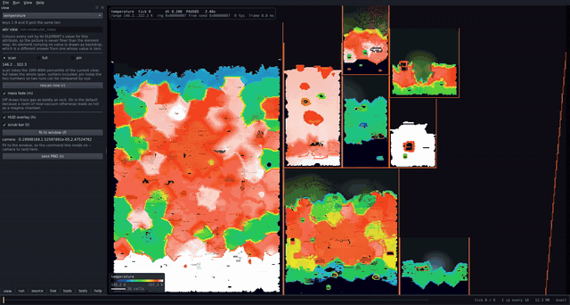
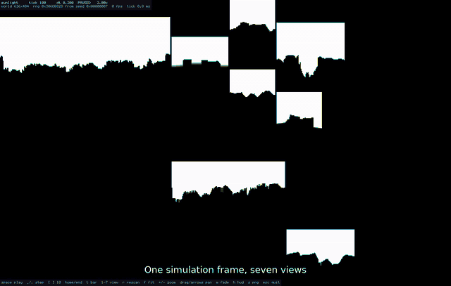

# oni-sim-visualizer

A standalone visualizer and debugger for the Oxygen Not Included simulation, as provided by
[oni-sim-replacement](https://github.com/Salacious-Oni-Dev/oni-sim-replacement).

**It is a separate program and is never loaded into the game.** It opens its own window and
works from one of two sources:

- **A recorded corpus** (`--corpus`). The program loads `SimDLL.dll` itself, replays the
  messages the game sent to it, and runs the simulation here. You can step forwards and
  backwards through it, because the state is this program's to checkpoint.
- **A running game** (`--attach host:port`). The program reads the live colony over a socket
  from the framework's debug server. Nothing is injected into the game. This mode goes forwards
  only: there is no history on this side of the connection.

Every view, probe and readout works the same way for both sources.

This is one part of the SDK. The managed framework API is in
[oni-framework-api](https://github.com/Salacious-Oni-Dev/oni-framework-api), the example mods
are in [oni-flagship-mods](https://github.com/Salacious-Oni-Dev/oni-flagship-mods), and the
guides are in [oni-sdk-docs](https://github.com/Salacious-Oni-Dev/oni-sdk-docs). The guide
[Visualizing the simulation](https://github.com/Salacious-Oni-Dev/oni-sdk-docs/blob/main/guides/simviz.md)
walks through recording a corpus and attaching to a game.

## Showcase videos

Click a preview to download the full video from the release.

| preview | what it shows |
|---|---|
| [](https://github.com/Salacious-Oni-Dev/oni-sim-visualizer/releases/download/v0.1.0-alpha.1/simviz-interactive.mp4) | **The interactive window** (2 min 38 s)<br>The start screen, where every choice becomes a command line a script can run. Then the views, the panels, stepping and scrubbing backwards through a recorded colony, the hover probe, and tests that run as child processes so the window never freezes. Recorded fullscreen at 2560x1440 with `--font large`. |
| [](https://github.com/Salacious-Oni-Dev/oni-sim-visualizer/releases/download/v0.1.0-alpha.1/simviz-showcase.mp4) | **Scripted reel** (37 s)<br>Made offline from `--snapshot` frames, with no window open: a tour of the views, then temperature, phase and element over 500 ticks of a six-asteroid colony, and a zoom into the main asteroid. |

## Requirements

- mingw-w64 (`x86_64-w64-mingw32-g++`) and bash, or Windows PowerShell with the WinLibs
  compiler (see Building on Windows). The program is a Windows x64 executable.
- A clone of `oni-sim-replacement` beside this repository, built once (its first build
  generates `abi/sim_abi.h` from your installed game).
- For `--corpus`: a corpus recorded from your own game, and a built `SimDLL.dll`.
- For `--attach`: the game running with the framework and Mod 1, launched with
  `--oni-debug-inspector`.

## Building

```sh
git clone https://github.com/Salacious-Oni-Dev/oni-sim-replacement
git clone https://github.com/Salacious-Oni-Dev/oni-sim-visualizer
(cd oni-sim-replacement && ONI_GAME=/path/to/OxygenNotIncluded ./sim/build.sh)
(cd oni-sim-visualizer && ./build.sh)
```

The output is `build/simviz.exe`. It uses no third-party libraries. If `oni-sim-replacement`
is somewhere else, set `ONI_SIM_REPO=/path/to/oni-sim-replacement`.

The ABI headers and the offline host code belong to `oni-sim-replacement` and are read from
it rather than copied here, so this program cannot drift out of step with the library it
drives.

### Building on Windows

`build.ps1` does what `build.sh` does, in Windows PowerShell, without WSL or bash. It builds
`build\simviz.exe`.

#### Tools

```powershell
winget install BrechtSanders.WinLibs.POSIX.UCRT   # g++ (MinGW-w64)
winget install Python.Python.3.12                 # for oni-sim-replacement's first build
winget install Git.Git                            # optional
```

Open a new PowerShell window afterwards. Windows does not run PowerShell scripts by default: run
`Set-ExecutionPolicy -Scope CurrentUser RemoteSigned` once, or use
`powershell -ExecutionPolicy Bypass -File` as below.

#### Build

The visualizer uses headers from `oni-sim-replacement`, cloned beside it and built once (that
build generates `abi\sim_abi.h` from your game install):

```powershell
git clone https://github.com/Salacious-Oni-Dev/oni-sim-replacement.git
git clone https://github.com/Salacious-Oni-Dev/oni-sim-visualizer.git
powershell -ExecutionPolicy Bypass -File oni-sim-replacement\sim\build.ps1 -OniGame "C:\Program Files (x86)\Steam\steamapps\common\OxygenNotIncluded"
powershell -ExecutionPolicy Bypass -File oni-sim-visualizer\build.ps1
.\oni-sim-visualizer\build\simviz.exe
```

Set `$env:ONI_SIM_REPO` if `oni-sim-replacement` is somewhere else. The Windows build adds
`-static` to the compiler flags so that `simviz.exe` runs without `libwinpthread-1.dll`; the other
flags are those of `build.sh`.

## Recording a corpus

A corpus holds the real messages the game sent to its simulation library: the complete boot
sequence of a loaded save plus one sample of every other message. You record it from your own
game with the passthrough shim in `oni-sim-replacement/shim/`. The steps are in the SDK guide
[Visualizing the simulation](https://github.com/Salacious-Oni-Dev/oni-sdk-docs/blob/main/guides/simviz.md#recording-a-corpus).
Record with no mods installed.

A corpus contains data from the game, including its element and disease tables. Keep it for
your own use and do not redistribute it. This repository's `.gitignore` excludes `*.bin`.

## Running

```sh
# no arguments: the start screen, which asks for a corpus or a host:port
./build/simviz.exe

# a corpus, in a window
./build/simviz.exe --corpus sim_corpus.bin --seed 7 --view temperature --window

# the same frame with no window: write a PNG
./build/simviz.exe --corpus sim_corpus.bin --seed 7 --ticks 200 --view temperature \
    --snapshot t200.png

# a running game
./build/simviz.exe --attach 127.0.0.1:9788 --view temperature --window
./build/simviz.exe --attach 127.0.0.1:9788 --probe 300,200
```

`--dll` picks the SimDLL a corpus runs on; the default is
`..\oni-sim-replacement\sim\build\SimDLL.dll`. `--seed` pins the simulation's random stream, so
a run is reproducible. Without it, a loaded world seeds from the clock and two runs of the same
command drift apart after a few hundred ticks. `--help` lists every flag, and `F1` in the
window opens the same reference.

`--font large` draws the panels and HUD in a 7x13 font instead of the default 5x8, for large
screens; the start screen picks it by itself on a screen 1440 px tall or more. `--ui-scale N`
(1, 2, 3 or 4) draws the whole window at N times size with sharp pixels, for very high-DPI
screens; `--size` stays the window size. `--fullscreen` opens the window borderless over the
whole monitor.

From WSL, `127.0.0.1` is not the Windows host. Use the address of the WSL virtual network
adapter on the Windows side instead.

**The debug server has no authentication and listens on every network interface.** Start the
game with `--oni-debug-inspector` only on a machine and network you trust, and only while you
are using it.

### Views

| key | view |
|---|---|
| `1` `2` `3` `4` | element, temperature, mass, phase |
| `5` | flow: the game's flow texture, hue for direction and brightness for magnitude |
| `6` | liquid: the game's liquid texture, composited as the game draws it |
| `7` | sunlight: the per-cell sunlight exposure that solar panels and plants read |
| `8` | a per-cell extension property, named with `--view ext:<name>` |
| `9` | a per-element extension attribute, named with `--view attr:<name>` |
| `0` | the game's own per-cell validity check: red for NaN, a cell over 10 t or 10 000 K, or one under 10 K |

The extension views are generic. The library's extension registries describe themselves, so
the hover card, `--probe`, `--ext-list` and `--ext-attrs` show whatever the simulation or a
mod has registered, by name. `--ext-list` also says how many cells hold something other than
the default, which is the quickest way to see whether a property is doing anything. Attached,
the registry is fetched only when asked for (`--ext`), because serialising it costs the game a
wait on the simulation thread.

### Keys

| | |
|---|---|
| `space` | play / pause |
| `.` | advance one tick |
| `,` | step back one tick |
| `[` `]` | ten ticks back / forward |
| `home` `end` | the two ends of the history |
| `t` | show/hide the scrub bar (drag it, or click to seek) |
| `r` | rescan the scalar range |
| `f` | fit the world to the window |
| `+` `-`, wheel | zoom (about the pointer) |
| arrows, left-drag | pan |
| `m` | mass fade on/off |
| `h` | hide the HUD |
| `s` | save the displayed frame as a PNG |
| `tab` | show/hide the control panels |
| `` ` `` | show/hide the output pane |
| `F1` | the flag reference |
| `esc` | quit |

Attached, the keys that move through history do nothing. `space` follows the game at the poll
interval and `.` asks for one frame.

The simulation advances only on a play frame or a press of `.`. Dragging, resizing or
repainting the window never moves it.

### Panels

`tab` opens a column of controls. Each control is one flag, and hovering it shows which. The
**tools** tab runs every readout against the world on screen (`--probe`, `--stats`,
`--digest`, `--ext-list`, `--dump-state` and others). The **tests** tab runs the longer
experiments (`--checkpoint-test`, `--timeline-test`, `--bisect`, `--diff-state` and others)
as child processes, with their output streaming into the pane. The **help** tab shows the
command line that reproduces what is on screen, camera included, so a view put together by
clicking can be handed to a script or a bug report.

## Checking

`test.sh` is the check suite. It runs three kinds of check:

- **Owned**: output this program produces with no simulation involved, such as the help text,
  the font sheet and sample frames of every panel. These should change only when the program
  does.
- **Relation**: claims that hold whatever the simulation does and whatever the world's size.
  The cells they use are placed relative to the world the corpus loads, and the one check that
  needs gas skips on a world without any. An offline render and an
  attached render of the same world are byte-identical; a seeded run reproduces across
  processes; a seek reproduces the run; a refusal refuses. The attached half is served by
  `tools/attach-stub.py`, which answers the framework's routes from a state file, so no game
  is needed.
- **Pinned**: numbers the simulation produces, such as digests and total mass. They hold only
  for the simulation source and corpus they were recorded with, and are skipped, with the
  reason, otherwise.

```sh
SIMVIZ_CORPUS=/path/to/sim_corpus.bin ./test.sh
```

With your own corpus, the pinned checks skip. Run `./test.sh --record` once to record goldens
for your corpus, and from then on the suite catches any change. `SIMVIZ_DLL` picks the SimDLL
under test. `SIMVIZ_STOCK_DLL`, pointed at a copy of the game's own `SimDLL.dll` taken out of
the game folder, enables the check that a library without the extension surface refuses
`--seed`. On Linux without WSL, set `SIMVIZ_RUNNER=wine`. The exit status is the number of failed checks.

## License

Mozilla Public License 2.0, see `LICENSE`.

## Credits

Oxygen Not Included is developed and published by Klei Entertainment. This project is not
affiliated with or endorsed by Klei.

Development of this project uses AI coding assistants. All changes are reviewed and released
by the maintainer.
